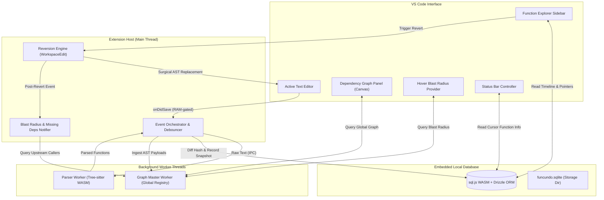

# FuncUndo

Granular, AST-aware function-level version control and dependency blast-radius analysis for Visual Studio Code.

[](https://www.typescriptlang.org/)
[](https://code.visualstudio.com/api)
[](https://webassembly.org/)
[](https://sql.js.org/)
[](https://orm.drizzle.team/)
[](https://jestjs.io/)

---

## Overview

Traditional undo in text editors operates at the file buffer level: reverting a change made ten minutes ago in one function also wipes out recent changes across unrelated functions in the same file. Similarly, Git commits are typically too coarse for tracking transient, exploratory changes during active development.

**FuncUndo** provides function-scoped semantic version control. By parsing code into an Abstract Syntax Tree (AST) in background worker threads, FuncUndo tracks function bodies as distinct entities. You can step backward or forward through the history of a single function without touching any surrounding code.

| Capability | Standard File Undo / Git | FuncUndo |
| :--- | :--- | :--- |
| **Granularity** | Entire file buffer or commit diff | Function and method boundaries |
| **Context** | Line-based textual diffs | Structural Abstract Syntax Tree (AST) |
| **Branching** | Linear file stack / explicit branches | Non-linear parent snapshot trees per function |
| **Safety Analysis** | Blind text replacement | Pre-revert blast radius and caller impact analysis |
| **Noise Filtering** | Tracks comment, whitespace, and formatting edits | Semantic hashing ignores non-executable changes |
| **Persistence** | Lost on editor close (undo stack) | Persisted locally in SQLite across sessions |

---

## Key Capabilities

### 1. Semantic Hashing & AST Tracking
- Compiles JavaScript and TypeScript files using `web-tree-sitter` (WebAssembly).
- Hashes AST nodes with SHA-256 while filtering out comments, semicolons, and pure formatting changes. Snapshots are only recorded when executable semantics change.

### 2. Non-Linear Branching & History Navigation
- Every snapshot records its `parentSnapshotId`, enabling true non-linear history trees when edits diverge after an undo.
- When stepping forward (redo) across multiple diverging edits, a native QuickPick menu lets you select the desired branch.
- The **Tracked Functions** sidebar displays version numbers, timestamps, and branch lineage (`from v<Parent>`).

### 3. Blast Radius & Cross-File Dependency Graph
- An in-memory bidirectional relational graph tracks caller-callee relationships across workspace files.
- Reverting or modifying a function triggers a debounced blast radius analysis (`SAFE`, `WARNING`, `DANGER`) identifying all impacted upstream callers.
- In-editor hover tooltips display live dependency metrics, and an interactive HTML5 Canvas webview renders the complete codebase dependency graph.

### 4. Surgical Reversion & Function Resurrection
- Reversions use `vscode.WorkspaceEdit` to replace exact character coordinate ranges without modifying other parts of the document.
- Deleted functions can be reverted back to life from the history explorer, with automated declaration wrapping for arrow functions (`const name = () => ...`).
- Passively notifies the user if an active function references a deleted function present in history.

### 5. Local Storage & Automated Pruning
- History is stored in an embedded SQLite database (`funcundo.sqlite`) using `sql.js` (WASM) and Drizzle ORM. Zero cloud dependencies, 100% offline.
- Runs an automated database vacuum on startup that prunes snapshots older than the retention threshold while guaranteeing a configurable minimum number of recent snapshots per function.

### 6. Non-Blocking Concurrency
- Heavy AST parsing and graph resolution run in dedicated Node.js `worker_threads` with message-passing IPC and automatic crash resurrection, keeping the VS Code extension host responsive.

---

## Architecture



---

## Keyboard Shortcuts & Commands

| Command | Keybinding (Win/Linux) | Keybinding (macOS) | Description |
| :--- | :--- | :--- | :--- |
| `chronos.undoFunction` | `Ctrl+Alt+Z` | `Cmd+Alt+Z` | Undo the function enclosing the cursor by 1 version. |
| `chronos.redoFunction` | `Ctrl+Alt+Y` | `Cmd+Alt+Y` | Redo the function enclosing the cursor (with branch picker). |
| `chronos.openFunctionExplorer` | — | — | Focus the Tracked Functions history sidebar. |
| `chronos.showDependencyGraph` | — | — | Open the interactive workspace dependency graph. |
| `chronos.mergeFunctions` | — | — | Merge histories of two functions after a refactor or rename. |
| `chronos.indexWorkspace` | — | — | Re-scan and parse all workspace files. |
| `chronos.refreshExplorer` | — | — | Refresh the history tree view. |

---

## Configuration Settings

Configure these in VS Code Settings (`Ctrl+,` or `Settings -> Extensions -> FuncUndo`):

| Setting | Type | Default | Description |
| :--- | :--- | :--- | :--- |
| `funcundo.retentionDays` | `number` | `30` | Number of days to retain snapshots before pruning eligible older records during startup vacuum. |
| `funcundo.minSnapshotsToKeep` | `number` | `20` | Minimum number of recent snapshots to preserve per function, regardless of age. |

---

## Tech Stack

- **Language & Runtime:** TypeScript (Strict), Node.js
- **AST Parsing:** `web-tree-sitter` (WebAssembly)
- **Database & Persistence:** `sql.js` (SQLite WASM) with `drizzle-orm`
- **Concurrency:** Node.js `worker_threads`
- **Visualization:** Native VS Code TreeView API, VS Code Webview (`vis-network`), Hover Provider
- **Testing:** Jest, `ts-jest` (52 unit tests across 6 suites)
- **Bundler:** `esbuild` with custom WASM asset pipeline

---

## Project Structure

```
chronos/
├── src/
│   ├── commands/     # Function merge and explorer commands
│   ├── graph/        # GlobalSymbolRegistry and relational graph engine
│   ├── lib/          # Shared type definitions and IPC interfaces
│   ├── reversion/    # Cursor detection and AST reversion engine
│   ├── storage/      # Drizzle schema, migrations, snapshots, reads, pointers, vacuum
│   ├── ui/           # TreeView provider, dependency graph panel, hover, status bar
│   ├── utils/        # Path normalizers and URI resolvers
│   ├── worker/       # Background worker managers and worker entrypoints
│   └── extension.ts  # Extension entrypoint, lifecycle, and orchestrator
├── media/            # Extension icons and assets
├── dist/             # Production bundle and WebAssembly binaries
├── esbuild.js        # esbuild build and WASM copying script
└── package.json      # Extension manifest and contributions
```

---

## Getting Started

### Prerequisites

- Node.js v18 or later
- Visual Studio Code v1.116.0 or later

### Installation & Build

1. Clone the repository:
   ```bash
   git clone https://github.com/ChronosTeamx/FuncUndo.git
   cd FuncUndo
   ```

2. Install dependencies:
   ```bash
   npm install
   ```

3. Build the extension bundle and copy WASM assets:
   ```bash
   npm run compile
   ```

4. Run tests and type check:
   ```bash
   npm run check-types
   npm run test:unit
   ```

5. Launch the extension:
   - Open the project directory in VS Code.
   - Press `F5` to start the **Extension Development Host**.

---

## Team

- **Jatin Jain** — Orchestration, Event Loop, and Pipeline
- **Mankirat Singh Nanda** — Storage Engine, Lineage, and Maintenance
- **Mayur Nanda** — AST Parser Engine and Tree-sitter Integration

---

## License

This project is licensed under the MIT License. See [LICENSE](LICENSE) for details.
