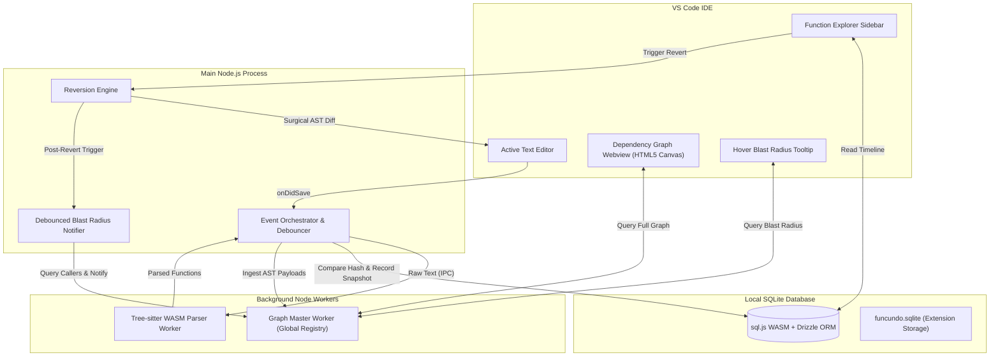

# ⏳ FuncUndo: The Semantic Code Time Machine


### *Stop undoing files. Start reverting logic.*

**FuncUndo** (internally *Chronos*) is a function-level version control system for VS Code. While Git tracks raw text lines, FuncUndo understands **Abstract Syntax Trees (AST)**. It tracks changes to your logic blocks silently in the background, allowing you to "time travel" individual functions without affecting the rest of your file.

---

## 🧐 Why FuncUndo?

Git is a blunt instrument for local, exploratory coding. When you’re deep in a "flow state," you don't want to commit every 2 minutes, but you also don't want to lose that brilliant version of a function you wrote an hour ago.

| Feature | Git / Standard Undo | **FuncUndo** |
| --- | --- | --- |
| **Granularity** | File or Line-level | **Function & Method-level** |
| **Context** | Raw text differences | **Semantic logic changes** |
| **Safety** | Blind reversion | **Blast radius & caller analysis** |
| **Noise** | Tracks whitespace/formatting | **Ignores non-logic changes** |

---

## ✨ Key Superpowers

* **🧠 AST-Aware Tracking:** Hashes code based on structural logic. If you only changed a comment or added whitespace, FuncUndo knows the logic is the same and won't clutter your history.
* **🕸️ Blast Radius & Dependency Graph:** Computes a real-time call graph of your workspace. Whenever you undo, redo, or revert, it delivers a non-intrusive debounced notification (1.5s–2s) showing the risk level and all impacted caller functions, with an interactive visual dependency graph and in-editor hover tooltips.
* **🔒 100% Local & Private:** Your code never leaves your machine. History is stored in a high-performance SQLite WASM database (`funcundo.sqlite`) within your extension storage.
* **⚡ Non-Blocking Architecture:** Heavy lifting is offloaded to Node.js Worker Threads (`worker_threads`). Your VS Code UI stays responsive while AST parsing and graph resolution occur in background workers.
* **🌐 WASM-Powered:** Built on `web-tree-sitter` and `sql.js` for zero native build dependencies. Works out-of-the-box on Windows, Mac, and Linux.

---

## 🏗 System Architecture

We strictly decouple the **Compiler Track** (Heavy Processing) from the **UI Track** (User Interaction) to ensure your editor never stutters.



---

## 🔄 The "Safe Revert" Lifecycle

1. **The Silent Loop:** Every time you save (or trigger debounced change detection), a background worker parses the file into an AST.
2. **Logic Fingerprinting:** We generate a semantic hash for every function body. If the executable logic changes, we record a new snapshot in SQLite with true parent lineage (`parentSnapshotId`).
3. **Blast Radius Analysis:** When you undo, redo, or revert, FuncUndo debounces (1.5s–2s) and surfaces an informative notification showing the risk level (`SAFE`, `WARNING`, `DANGER`) and all impacted callers, with a 1-click shortcut to inspect the visual Dependency Graph.
4. **Surgical Patching:** Instead of a full file overwrite, we use `vscode.WorkspaceEdit` to replace only the specific character coordinates of the target function.

---

## 🛠 Tech Stack

* **Parser:** `web-tree-sitter` (Compiled to WebAssembly)
* **Database:** `sql.js` (SQLite compiled to WASM) with `Drizzle ORM` for type-safe schema definitions and versioned migrations.
* **Frontend & Visuals:** Native VS Code TreeView API, in-editor Markdown hover tooltips, and an interactive force-directed HTML5 Canvas dependency graph.
* **Concurrency:** Node.js `worker_threads` for non-blocking AST parsing and in-memory graph resolution.

---

## 💻 Local Development

### Prerequisites

* Node.js v18+
* VS Code

### Installation

1. **Clone the repo:**
```bash
git clone https://github.com/ChronosTeamx/FuncUndo.git
cd FuncUndo
```

2. **Install & Build:**
```bash
npm install
npm run compile # Compiles TS and copies WASM binaries
```

3. **Launch:**
Press `F5` in VS Code to open the **Extension Development Host**.

---

## 📂 Project Structure

```bash
chronos/
├── src/
│   ├── worker/       # Background Node Workers (Parser & GraphMaster)
│   ├── graph/        # GlobalSymbolRegistry & Directed Relational Graph
│   ├── storage/      # Drizzle Schema, Migrations, Snapshots, & Reads
│   ├── ui/           # TreeView Provider, Dependency Graph Canvas, & Hover Tooltips
│   ├── reversion/    # Cursor Finder & AST Reversion Engine
│   ├── commands/     # User-controlled Function Merge Commands
│   └── extension.ts  # Extension Entrypoint & Orchestrator
├── media/            # Icons and styling assets
└── esbuild.js        # Production bundler script
```

---

## 🔮 Future Roadmap

* **Phase 2:** Support for Python, Go, and Rust (via additional Tree-sitter WASM grammars).
* **Phase 3:** **Visual Churn Heatmap**—See which functions are the most "unstable" over time.
* **Phase 4:** AI-Generated summaries of what changed between two function versions.

---

## 🤝 The Team

* **Jatin Jain** - The Event Loop & Orchestration
* **Mankirat Singh Nanda** - Storage Engine 
* **Mayur Nanda** - Parser Engine

---

*Found a bug? Open an issue. Want to contribute? Check out `CONTRIBUTING.md`.*


